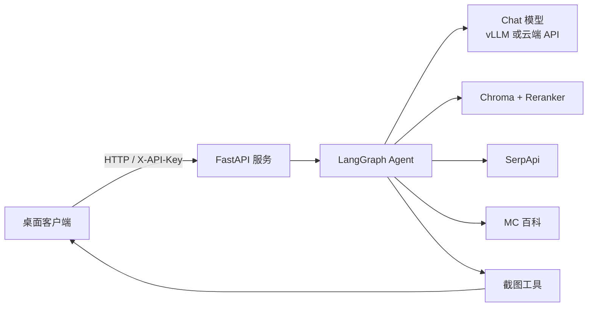
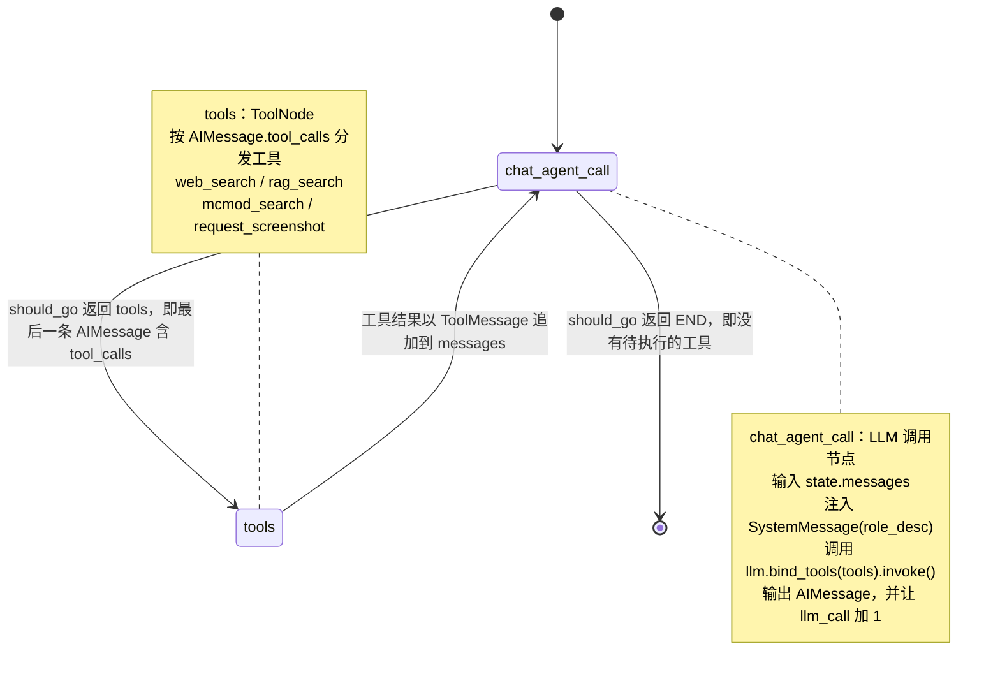
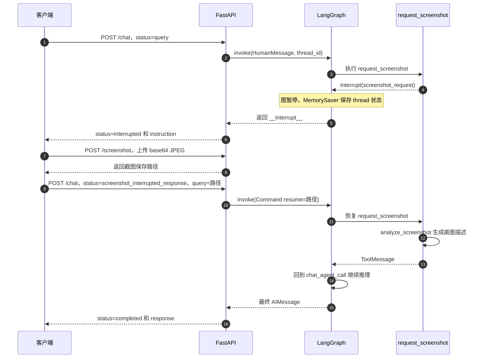

# Desktop Assistant

一个桌面智能体服务。项目通过 OpenAI 兼容接口调用 Chat 模型（本地 vLLM 或云端 API），使用 LangGraph 组织 Agent 工作流，并结合本地知识库、联网搜索、Minecraft 百科查询和屏幕截图能力，为桌面端提供对话体验。

## 功能特性

- **OpenAI 兼容 LLM**：连接本地 vLLM，或通过 API Key 调用云端 OpenAI 兼容接口。
- **RAG 知识库检索**：使用 Chroma 向量库检索本地资料，并通过 CrossEncoder 重排序。
- **联网搜索**：通过 SerpApi 获取实时 Google 搜索结果。
- **MC 百科查询**：查询 MC 百科物品信息及相关评论。
- **屏幕理解**：客户端倒计时截屏，服务端按需读取截图并继续当前会话。
- **流式响应**：通过 NDJSON 推送 Agent 工具调用进度和最终结果。
- **会话状态**：使用 LangGraph `MemorySaver` 按 `thread_id` 保存图状态，支持截图中断后的恢复。
- **接口鉴权**：可通过 `X-API-Key` 请求头保护聊天和截图接口。
- **日志记录**：记录对话、工具调用、模型输出和异常信息，便于调试。

## 工作流程



用户问题进入 Agent 后，模型会根据问题自主选择工具。工具返回结果后，Agent 汇总上下文并生成最终回答；如果需要了解当前屏幕内容，服务端会请求客户端截图，客户端上传后继续原会话。

## LangGraph 状态图

Agent 的图定义在 [agent/core.py](agent/core.py)，状态结构定义在 [infrastructure/schema.py](infrastructure/schema.py)。图编译时绑定 `MemorySaver` 检查点，以 `thread_id` 为键保存执行状态：同一线程内的工具循环和截图中断恢复都依赖它；每次 `status=query` 的新问题会先调用 `delete_thread` 清空旧状态。

### 图状态

| 字段 | 类型 | 说明 |
| --- | --- | --- |
| `messages` | `Annotated[List[AnyMessage], operator.add]` | 系统、用户、AI 和工具消息按顺序累积；节点返回的 `messages` 由 reducer 追加，而不是覆盖 |
| `llm_call` | `int` | 每进入一次 `chat_agent_call` 加 1，用于观察工具循环次数 |

### 节点与边



`START` 与 `END` 是 LangGraph 的虚拟节点（编译后为 `__start__` 和 `__end__`），图中只有两个真实节点：

| 节点 / 边 | 类型 | 结构说明 |
| --- | --- | --- |
| `START` → `chat_agent_call` | 普通边 | 每次 `invoke` 都从入口进入 LLM 节点 |
| `chat_agent_call` | LLM 节点 | 由 `make_chat_agent_call(tool_list, llm)` 闭包构造（LangGraph 节点只能接收 state）；节点内把角色描述作为 `SystemMessage` 拼在消息历史前，调用绑定了工具的模型，返回 `AIMessage` 和递增后的 `llm_call` |
| `chat_agent_call` → `tools` | 条件边 | `should_go` 检查最后一条消息的 `tool_calls`，非空则返回 `"tools"` |
| `chat_agent_call` → `END` | 条件边 | 没有工具调用时返回 `END`，最后一条 `AIMessage` 即最终回答 |
| `tools` | `ToolNode` | 读取最后一条 `AIMessage` 的 `tool_calls`，依次执行对应工具，并为每个调用生成一条 `ToolMessage` |
| `tools` → `chat_agent_call` | 普通边 | 工具结果回填后重新进入 LLM 节点，形成“模型思考 → 调用工具 → 汇总结果”的 ReAct 循环 |

`tools` 节点的内部工具：

| 工具 | 作用 | 返回内容 |
| --- | --- | --- |
| `web_search` | 通过 SerpApi 执行 Google 联网搜索 | 搜索结果摘要 |
| `rag_search` | Chroma 向量检索，可选 CrossEncoder 重排 | 与问题相关的本地资料片段 |
| `mcmod_search` | 查询 MC 百科 | 物品信息及相关评论 |
| `request_screenshot` | 请求用户当前屏幕截图 | 调用时通过 `interrupt` 暂停会话，恢复后返回截图的文字描述 |

工具分发发生在 `ToolNode` 内部，不会为每个工具单独创建图节点。`infrastructure/schema.py` 中的 `screenshot_llm_state` 是预留的截图子图状态，当前没有编译进主图。

### 截图中断与恢复

`request_screenshot` 是图中唯一会暂停执行的工具。它调用 LangGraph 的 `interrupt()`，把截图指导交给客户端；`MemorySaver` 保存当前 `thread_id` 的完整状态。客户端上传截图后，服务端用 `Command(resume=截图路径)` 恢复同一个线程：



执行要点：

- `interrupt` 之前的状态（消息历史、工具调用参数）由检查点保存，恢复时不会重跑整个对话。
- 客户端上传截图后，服务端把返回的 `path` 作为 `Command(resume=...)` 的值传回工具；`analyze_screenshot` 读取图片并生成描述，作为 `ToolMessage` 写回 `messages`。
- 恢复后仍按同一张图继续执行，模型可以再次调用工具，也可以直接生成最终回答。
- 如果视觉识别失败，`analyze_screenshot` 会返回一段降级说明，Agent 仍可继续回答。

## 项目结构

```text
Agent_Master/
├── agent/                 # Agent 构建与核心对话流程
├── client/                # 命令行客户端与截图上传逻辑
├── infrastructure/        # Chat、Embedding、向量库和重排模型加载
├── tools/                 # RAG、联网搜索、MC 查询、截图工具
├── tests/                 # Agent 调试与检索测试
├── data/
│   └── role_description.txt  # Agent 角色描述
├── app.py                 # FastAPI 服务入口
├── config.py              # 环境变量和本地模型配置
├── logging_config.py      # 日志配置
├── .env.example           # 环境变量模板
└── requirements.txt       # Python 基础依赖
```

## 环境要求

- Python 3.11（服务端 conda 环境：`agent_assistrant_server`）
- 任意 OpenAI 兼容的 Chat 接口：本地 vLLM，或云端 API（如 DashScope）
- 可选：本地 Chroma 向量库、角色描述文件、CrossEncoder 重排序模型
- SerpApi API Key（仅使用联网搜索时需要）

## 安装

服务端（新建环境）：

```bash
conda create -n agent_assistrant_server python=3.11 -y
conda activate agent_assistrant_server
pip install -r requirements.txt
```

客户端依赖 `requests`、`mss`、`pillow`、`python-dotenv`。使用已有的 `agent` 环境，缺少依赖时补装：

```bash
conda activate agent
pip install requests mss pillow python-dotenv
```

## 配置

编辑 `.env`：

```dotenv
SERPAPI_API_KEY=your_serpapi_key
AGENT_API_KEY=replace_with_a_long_random_agent_key

# 使用云端 API Key 时（不需要本地 vLLM）
LLM_API_KEY=your_api_key
LLM_BASE_URL=https://dashscope.aliyuncs.com/compatible-mode/v1
LLM_MODEL=your_chat_model

# 可选：RAG 嵌入 / 重排序
EMBED_MODEL=your_embedding_model
EMBED_BASE_URL=https://dashscope.aliyuncs.com/compatible-mode/v1
RERANK_MODEL=your_reranker_model
```

真实密钥只放在本地 `.env` 中，不要提交到 GitHub。项目已经通过 `.gitignore` 忽略 `.env`。

当 `CHAT_MODEL` / `CHAT_BASE_URL` 未配置时，会自动回退到 `LLM_MODEL` / `LLM_BASE_URL`，因此本地 vLLM 与云端 API 两种方式可以共用一套配置。

模型、向量库和截图目录目前在 `config.py` 中配置，部署前请按实际路径修改：

- `LLM_MODEL`、`LLM_BASE_URL`（或旧配置名 `CHAT_MODEL`、`CHAT_BASE_URL`）
- `EMBED_MODEL`、`EMBED_BASE_URL`
- `RERANKER_MODEL`、`RERANKER_DEVICE`
- `PERSIST_DIR`
- `ROLE_DESC_PATH`
- `SCREENSHOT_DIR`

其中 `ROLE_DESC_PATH` 指向 Agent 的角色描述文件（仓库内置 `data/role_description.txt`），`PERSIST_DIR` 指向已经构建好的 Chroma 数据目录（缺失时 RAG 工具返回“未找到相关资料”）。未安装 `sentence-transformers` 时，重排序会自动退化为向量检索顺序。

## 启动服务

确认 `.env` 中的 `LLM_BASE_URL`、`LLM_MODEL`、`LLM_API_KEY` 可用（本地 vLLM 或云端 API 均可），然后启动 FastAPI：

```bash
conda activate agent_assistrant_server
cd Agent_Master
python app.py
```

默认服务地址：

```text
http://localhost:8002
```

也可以使用 Uvicorn：

```bash
uvicorn app:app --host 0.0.0.0 --port 8002
```

健康检查：

```bash
curl http://localhost:8002/health
```

返回：

```json
{"status":"ok"}
```

## 使用客户端

服务端启动完成后，在另一个终端运行：

```bash
cd Agent_Master
python -m client
```

客户端默认连接 `localhost:8002`，并从 `.env` 读取 `AGENT_API_KEY`。也可以手动指定参数：

```bash
python -m client \
  --host localhost \
  --port 8002 \
  --api-key "$AGENT_API_KEY" \
  --quality 70
```

输入 `exit` 退出客户端。涉及当前屏幕内容的问题，客户端会按服务端指令倒计时截图并上传。

## API 接口

### 健康检查

```http
GET /health
```

### 普通对话

```http
POST /chat
X-API-Key: your_agent_api_key
Content-Type: application/json
```

请求示例：

```json
{
  "query": "请介绍一下本地知识库中的内容",
  "thread_id": "demo-session",
  "status": "query"
}
```

`status` 默认为 `query`。当 Agent 返回 `status=interrupted` 且 `interrupt.type=screenshot_request` 时，客户端完成截图上传后，需要以 `status=screenshot_interrupted_response` 再次调用 `/chat`，并把 `query` 设为 `/screenshot` 返回的截图路径。

### 流式对话

```http
POST /chat/stream
X-API-Key: your_agent_api_key
Content-Type: application/json
```

响应为逐行返回的 NDJSON，事件类型包括 `progress`、`result` 和 `error`。

### 上传截图

```http
POST /screenshot
X-API-Key: your_agent_api_key
Content-Type: application/json
```

```json
{
  "image": "base64_encoded_jpeg",
  "thread_id": "demo-session"
}
```

上传成功后会返回截图在服务端的保存路径。客户端随后用该路径和 `status=screenshot_interrupted_response` 调用 `/chat`，即可让被 `request_screenshot` 中断的图继续执行。完整时序见[截图中断与恢复](#截图中断与恢复)。

当 `AGENT_API_KEY` 未配置时，服务会跳过鉴权，仅适合本地开发环境。对外部署时务必设置强随机密钥，并建议放在反向代理或内网访问控制之后。

## 测试与调试

运行语法检查：

```bash
python -m py_compile config.py client/agent_client.py
```

运行 Agent 调试测试：

```bash
python tests/test_agent.py "关于茶会礼仪"
```

不传参数时进入交互模式：

```bash
python tests/test_agent.py
```

这些测试会加载 Chat 模型并尝试连接向量库，首次运行可能较慢，具体耗时取决于模型部署方式或网络情况。

## 安全说明

- `.env`、日志、Python 缓存和运行时文件不会提交到仓库。
- 发布代码前请确认没有把 API Key、密码、Token 或本地数据路径中的敏感信息写入源码。
- 如果密钥曾经出现在 Git 历史中，应立即在对应服务后台撤销并重新生成。
- 不建议将 `AGENT_API_KEY` 设置为简单字符串。
- 生产环境请关闭不必要的公网访问，并配置 HTTPS、反向代理和访问限流。

## 许可证

当前仓库未声明开源许可证。公开发布前，请根据项目依赖和代码归属补充合适的许可证文件。
